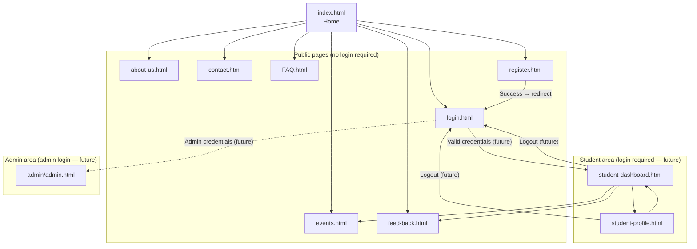

# StudentHub — Site Map & User Flow

> **Project phase:** Phase 3 (HTML + CSS complete)  
> **Purpose of this document:** Map every page and show how users move through the site.

---

## 1. Overview

StudentHub is a college portal with three user areas:

| Area | Who | Entry point |
|------|-----|-------------|
| **Public site** | Visitors & students (not logged in) | `index.html` |
| **Student portal** | Logged-in students | `page/student-dashboard.html` |
| **Admin console** | Staff / administrators | `admin/admin.html` |

---

## 2. Complete Page Map

```
Student-Hub-Test/
├── index.html                      # Home (landing page)
├── page/
│   ├── about-us.html               # About the portal / institution
│   ├── contact.html                # Contact form & support info
│   ├── events.html                 # Campus events listing
│   ├── FAQ.html                    # Frequently asked questions
│   ├── feed-back.html              # Feedback form
│   ├── login.html                  # Student login
│   ├── register.html               # New student registration
│   ├── student-dashboard.html      # Student home (after login)
│   └── student-profile.html        # Student profile & settings
└── admin/
    └── admin.html                  # Admin dashboard (separate area)
```

---

## 3. High-Level User Flow



---

*Last updated: Phase 3 — HTML/CSS complete. Aligns with `Drawio/Sitemap-True.drawio` user flow diagram.*
